# Demand Forecasting Report: daily household electricity consumption

*Generated by `run_pipeline.py`. Dataset: UCI Individual Household Electric Power Consumption
(2,075,259 one-minute readings, aggregated to 1440 daily values of energy in kWh,
2006-12-17 to 2010-11-25).* Runtime 18.2 min on CPU.

## 1. Executive summary

* **Best model on the hold-out window: `Ensemble(mean)`** with MAE 4.43 kWh
  (MAPE 19.4 %, MASE 0.65),
  a **35 % error reduction** versus the weekly seasonal-naive baseline.
* Translated to a retailer procuring energy for 100,000 households with this profile,
  forecast error costs **EUR 13.35M per year** with the best model versus
  **EUR 23.61M** with the naive rule, a saving of **EUR 10.26M per year**.
* Forecast error grows with horizon: the best model's MAE goes from 1.64 kWh one day
  ahead to 4.15 kWh four weeks ahead (section 5). Re-forecasting at least weekly
  keeps the operational error near the short-horizon figure.
* The first hold-out origin falls in a vacation week (consumption near 9 kWh): no model
  anticipates an empty house from history alone, which is the single biggest source of error
  and the clearest case for an external "occupancy / holiday calendar" regressor.
* Distribution drift between the training year and the hold-out window is
  **stable** (seasonally adjusted PSI 0.050); the residual
  monitors fired 7 Page-Hinkley alarm(s) and the rolling MAE
  exceeded tolerance on 25 of the hold-out days.
  The retraining plan in `docs/retraining_and_drift_plan.md` turns these monitors into operating rules.

## 2. Data exploration

| statistic | value |
|---|---|
| days | 1440 (22 imputed, 1.5 %) |
| mean / std | 26.13 / 9.96 kWh |
| weekday vs weekend mean | 24.82 vs 29.41 kWh |
| winter (DJF) vs summer (JJA) mean | 33.95 vs 17.42 kWh |
| linear trend | -3.7 % of mean per year |
| seasonal strength weekly / yearly / trend | 0.24 / 0.61 / 0.003 |
| ADF p-value / KPSS p-value | 0.0048 / 0.100 |
| anomalies flagged (robust z > 4 on STL remainder) | 108 |

**Trend.** Consumption declines slowly (-3.7 % per year), visible in the
28-day mean and in the year-over-year overlay. The trend component explains almost none of
the variance compared with seasonality.

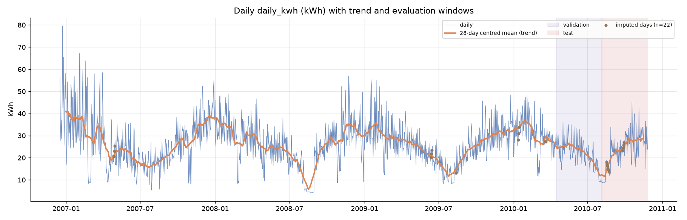

**Seasonality.** The yearly cycle dominates (winter heating roughly doubles summer use) and a
weekly cycle adds about 4.6 kWh on weekends. The ACF shows
spikes at lags 7, 14, 21 and a slow decay from the yearly cycle.

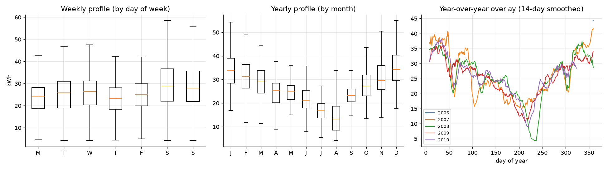
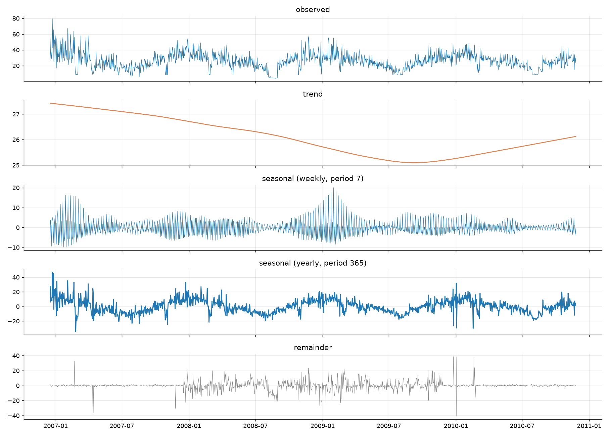
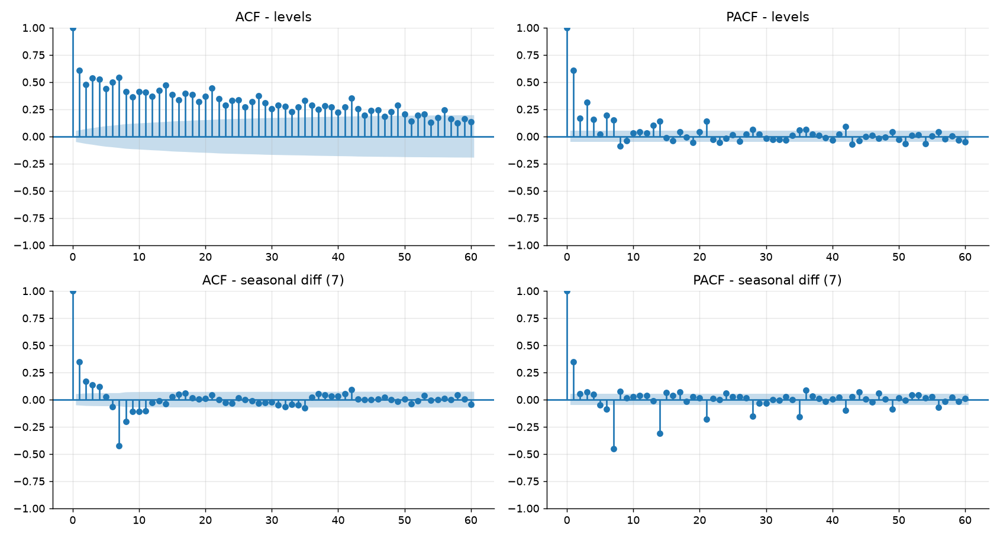

**Stationarity.** ADF rejects a unit root and KPSS does not reject stationarity: the level series is stationary (d=0). Seasonality is handled with seasonal terms / Fourier regressors rather than regular differencing.

**Anomalies.** Robust (MAD-based) z-scores on the STL remainder flag 108 days (7.5 %). The largest are
holiday-period spikes (Christmas 2006, late February 2007 cold snap) and dips when the house is empty
(for example 2007-02-25: 8.36 kWh). Days with under
90 % of minute readings were treated as missing and interpolated (marked in the first figure)
rather than being allowed to masquerade as demand collapses.

| date | value | robust z | type |
|---|---|---|---|
| 2006-12-23 | 79.56 | 14.97 | spike |
| 2007-02-25 | 8.36 | -12.77 | dip |
| 2006-12-26 | 65.57 | 11.89 | spike |
| 2007-02-22 | 56.24 | 11.07 | spike |
| 2007-02-20 | 52.5 | 10.88 | spike |
| 2008-11-24 | 53.55 | 10.75 | spike |
| 2007-03-31 | 58.49 | 10.18 | spike |
| 2007-01-06 | 25.14 | -9.57 | dip |
| 2006-12-20 | 37.1 | 9.3 | spike |
| 2010-02-21 | 45.67 | 9.02 | spike |

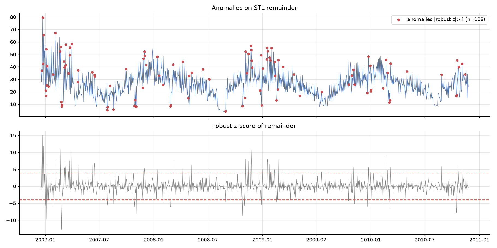
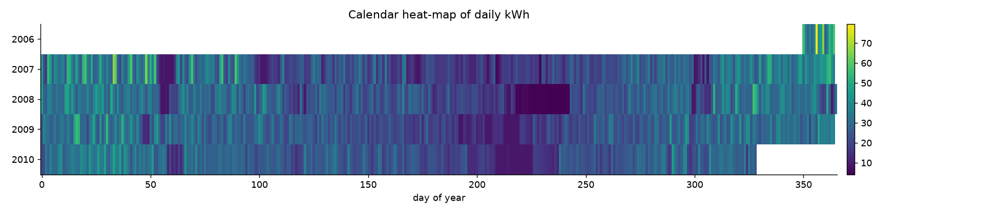
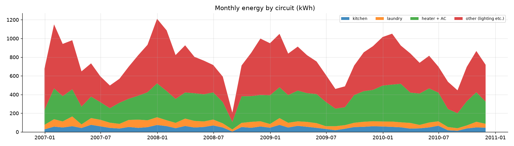

## 3. Time-based features

Implemented in `src/features.py` and used by SARIMAX (Fourier terms), the GBM (all) and the
LSTM / GRU (calendar block):

* calendar: day of week, weekend flag, month, quarter, French public-holiday flag;
* cyclical encodings: sin/cos of day-of-week, day-of-year and month;
* Fourier harmonics of the 365.25-day cycle (K = 3) as exogenous regressors;
* target lags (1 to 28 days, 364 days), rolling mean / std / min / max (7, 14, 28 days), EWMs,
  and a year-over-year level ratio. For the direct GBM every lag is shifted by the 28-day horizon.

Permutation importance of the GBM (fit on train+validation), top features:

| feature | importance |
|---|---|
| doy_cos | 0.504 |
| doy_sin | 0.106 |
| dayofweek | 0.043 |
| lag_371 | 0.040 |
| roll_std_56 | 0.035 |
| roll_min_28 | 0.030 |
| roll_std_14 | 0.030 |
| lag_364 | 0.029 |
| lag_28 | 0.029 |
| lag_42 | 0.028 |
| lag_35 | 0.026 |
| lag_29 | 0.025 |

## 4. Models compared

| family | model | configuration |
|---|---|---|
| baseline | SeasonalNaive(7) | value 7 days ago |
| baseline | SeasonalMean(4w) | weekday mean of the last 4 weeks |
| baseline | LastYearScaled | same weekday one year ago, re-scaled to the recent level |
| statistical | `SARIMA(1, 0, 2)x(1, 1, 1, 7)` | weekly seasonal ARIMA, order chosen by AIC grid search |
| statistical | `SARIMAX(1, 0, 2)x(1, 1, 1, 7)+F3` | same + Fourier yearly regressors (dynamic harmonic regression) |
| structural | `Prophet(cps=0.2,sps=10.0,add)` | Prophet, weekly + yearly seasonality, FR holidays; priors tuned on validation; refit at every origin |
| ML features | GBM(features,direct) | histogram gradient boosting on calendar + lag features, direct 28-step |
| deep | LSTM | hidden 64, layers 2, lookback 56, direct 28-step head with future calendar features |
| deep | GRU | hidden 64, layers 1, same architecture |
| ensemble | Ensemble(mean) | mean of the 3 best non-baseline models on validation: GRU, LSTM, Prophet(cps=0.2,sps=10.0,add) |

Evaluation protocol: chronological split train (2006-12-17 to 2010-04-15),
validation (2010-04-16 to 2010-08-05, 112 days) and
hold-out test (2010-08-06 to 2010-11-25, 112 days).
Hyper-parameters are chosen on validation only. Models are then refit on train+validation and
asked for 28-day forecasts from rolling origins every 14 days in the
test window (7 origins, 196 forecast points per model). Prophet refits at every origin; SARIMAX
re-applies its fitted parameters to the longer history (Kalman filter update) without re-estimation.

## 5. Forecast accuracy

### Hold-out test window

|  | MAE | RMSE | MAPE_% | sMAPE_% | MASE | Bias |
|---|---|---|---|---|---|---|
| Ensemble(mean) | 4.426 | 6.063 | 19.429 | 18.537 | 0.646 | -0.291 |
| GRU | 4.552 | 6.153 | 20.147 | 19.178 | 0.664 | -0.435 |
| Prophet(cps=0.2,sps=10.0,add) | 4.558 | 6.194 | 20.712 | 19.277 | 0.665 | 0.323 |
| LSTM | 4.622 | 6.270 | 20.261 | 19.952 | 0.674 | -0.762 |
| SARIMAX(1, 0, 2)x(1, 1, 1, 7)+F3 | 4.716 | 6.067 | 21.791 | 20.049 | 0.688 | 0.348 |
| SARIMA(1, 0, 2)x(1, 1, 1, 7) | 5.466 | 6.879 | 22.449 | 23.474 | 0.798 | -2.845 |
| GBM(features,direct) | 6.034 | 7.806 | 26.899 | 29.755 | 0.881 | -2.002 |
| LastYearScaled | 6.099 | 8.091 | 29.611 | 24.990 | 0.890 | 0.835 |
| SeasonalMean(4w) | 6.548 | 7.981 | 27.612 | 30.268 | 0.956 | -4.116 |
| SeasonalNaive(7) | 6.829 | 8.629 | 28.338 | 30.639 | 0.997 | -2.511 |

MASE below 1 means better than an in-sample seasonal-naive forecast. Bias is forecast minus
actual (negative = under-forecast).

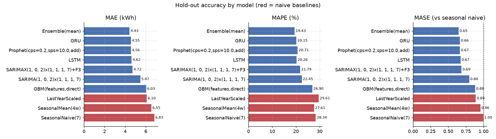

### Validation window (used for model selection)

|  | MAE | RMSE | MAPE_% | sMAPE_% | MASE | Bias |
|---|---|---|---|---|---|---|
| GRU | 3.422 | 4.291 | 16.861 | 15.911 | 0.485 | -0.071 |
| Ensemble(mean) | 3.458 | 4.285 | 16.888 | 16.080 | 0.490 | -0.330 |
| LSTM | 3.487 | 4.349 | 17.357 | 16.225 | 0.494 | 0.013 |
| Prophet(cps=0.2,sps=10.0,add) | 3.775 | 4.649 | 17.932 | 17.547 | 0.535 | -0.931 |
| SARIMAX(1, 0, 2)x(1, 1, 1, 7)+F3 | 3.801 | 4.814 | 18.033 | 17.855 | 0.538 | -1.304 |
| GBM(features,direct) | 4.035 | 5.028 | 18.547 | 18.621 | 0.572 | -1.478 |
| SeasonalMean(4w) | 4.776 | 6.222 | 27.014 | 21.672 | 0.677 | 2.568 |
| SARIMA(1, 0, 2)x(1, 1, 1, 7) | 4.813 | 6.054 | 27.116 | 21.951 | 0.682 | 2.473 |
| LastYearScaled | 4.927 | 6.284 | 22.635 | 23.142 | 0.698 | -1.501 |
| SeasonalNaive(7) | 5.154 | 6.531 | 26.962 | 23.474 | 0.730 | 1.085 |

### Error by forecast horizon (MAE, hold-out)

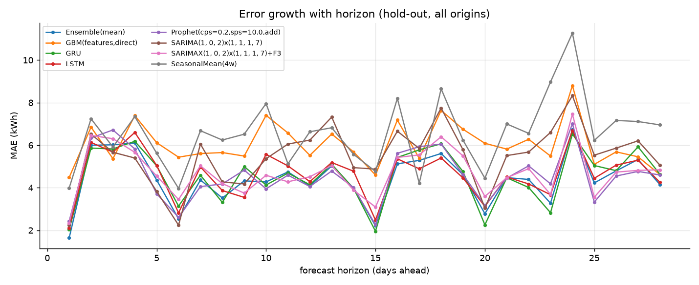

| horizon | Ensemble(mean) | GBM(features,direct) | GRU | LSTM | LastYearScaled | Prophet(cps=0.2,sps=10.0,add) | SARIMA(1, 0, 2)x(1, 1, 1, 7) | SARIMAX(1, 0, 2)x(1, 1, 1, 7)+F3 | SeasonalMean(4w) | SeasonalNaive(7) |
|---|---|---|---|---|---|---|---|---|---|---|
| 1 | 1.64 | 4.48 | 2.04 | 2.11 | 3.80 | 2.43 | 2.25 | 2.34 | 3.99 | 4.75 |
| 7 | 4.36 | 5.61 | 4.59 | 4.98 | 5.06 | 4.05 | 6.05 | 5.03 | 6.68 | 6.95 |
| 14 | 3.97 | 5.68 | 3.96 | 4.77 | 4.91 | 4.00 | 4.94 | 3.89 | 5.57 | 6.84 |
| 21 | 4.47 | 5.81 | 4.47 | 4.50 | 4.47 | 4.45 | 5.51 | 4.47 | 7.00 | 4.12 |
| 28 | 4.15 | 4.62 | 4.64 | 4.25 | 4.70 | 4.60 | 5.06 | 4.84 | 6.95 | 6.60 |

### Forecasts versus actuals

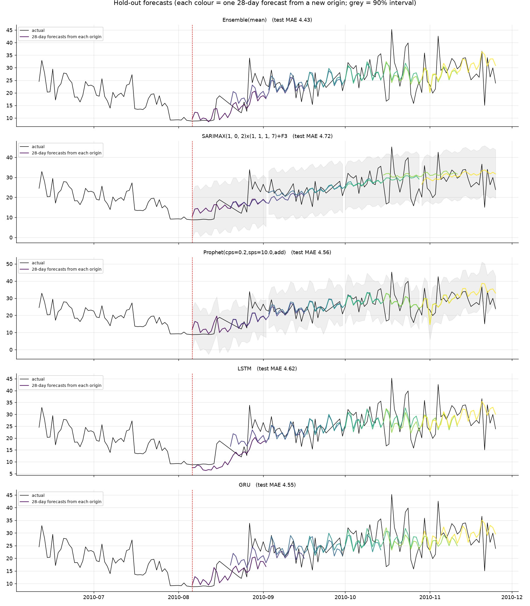
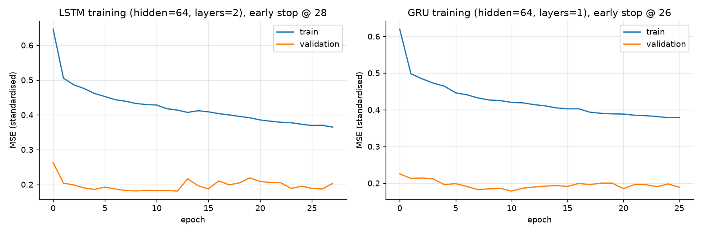

### Compute cost (seconds to produce the 7 rolling hold-out forecasts)

|  | forecast_seconds_7_origins |
|---|---|
| SeasonalNaive(7) | 0.0 |
| SeasonalMean(4w) | 0.0 |
| LastYearScaled | 0.0 |
| SARIMA(1, 0, 2)x(1, 1, 1, 7) | 1.1 |
| SARIMAX(1, 0, 2)x(1, 1, 1, 7)+F3 | 1.3 |
| Prophet(cps=0.2,sps=10.0,add) | 4.9 |
| GBM(features,direct) | 0.6 |
| LSTM | 0.3 |
| GRU | 0.3 |

## 6. Business impact of forecast error

Scenario: an electricity retailer buys energy day-ahead for **100,000 households**
with this consumption profile. Energy bought but not used is resold at a loss of
**EUR 0.04/kWh**; a shortfall is bought on the balancing market at a
premium of **EUR 0.12/kWh** (3x more expensive, so under-forecasting
hurts more than over-forecasting). Costs are computed on every hold-out forecast point and annualised.
All assumptions live in `src/config.py` and can be replaced with real tariffs.

|  | mean_abs_error | share_days_under_forecast | mean_daily_cost_per_profile | annual_cost_portfolio | annual_buffer_cost_portfolio |
|---|---|---|---|---|---|
| Prophet(cps=0.2,sps=10.0,add) | 4.558 | 0.490 | 0.352 | 12,837,995 | 12,739,566 |
| SARIMAX(1, 0, 2)x(1, 1, 1, 7)+F3 | 4.716 | 0.480 | 0.363 | 13,261,168 | 12,546,413 |
| Ensemble(mean) | 4.426 | 0.531 | 0.366 | 13,350,296 | 14,231,344 |
| GRU | 4.552 | 0.531 | 0.382 | 13,926,956 | 13,884,589 |
| LSTM | 4.622 | 0.577 | 0.400 | 14,608,999 | 15,622,268 |
| LastYearScaled | 6.099 | 0.531 | 0.454 | 16,588,647 | 13,393,018 |
| SARIMA(1, 0, 2)x(1, 1, 1, 7) | 5.466 | 0.684 | 0.551 | 20,114,011 | 19,278,271 |
| GBM(features,direct) | 6.034 | 0.602 | 0.563 | 20,542,991 | 19,376,175 |
| SeasonalNaive(7) | 6.829 | 0.612 | 0.647 | 23,605,568 | 23,639,358 |
| SeasonalMean(4w) | 6.548 | 0.740 | 0.688 | 25,130,003 | 20,915,595 |

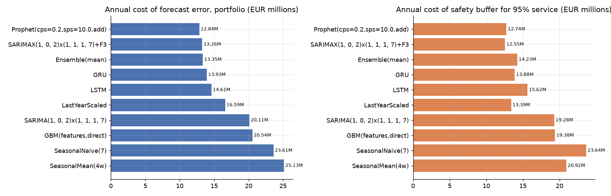

Reading the table:

* The best model saves **EUR 10.26M per year** relative to the
  seasonal-naive rule and **EUR 11.78M**
  relative to the stronger 4-week seasonal mean.
* Because the cost is asymmetric, a biased model is penalised even when its MAE looks fine: compare
  the `Bias` column of section 5 with the cost ranking here.
* **Service level / safety buffer.** To cover demand on 95 % of days the planner adds a
  buffer equal to the 95th percentile of past under-forecasts. Calibrated on the
  validation window, the buffer and the service level actually achieved on the hold-out are:

| model | buffer_from_validation | achieved_service_level_test | buffer_share_of_mean_demand_% |
|---|---|---|---|
| SARIMA(1, 0, 2)x(1, 1, 1, 7) | 6.745 | 0.745 | 28.201 |
| SeasonalMean(4w) | 7.564 | 0.668 | 31.626 |
| Ensemble(mean) | 7.573 | 0.929 | 31.665 |
| Prophet(cps=0.2,sps=10.0,add) | 7.593 | 0.923 | 31.747 |
| LSTM | 7.902 | 0.929 | 33.039 |
| GRU | 8.202 | 0.929 | 34.295 |
| SARIMAX(1, 0, 2)x(1, 1, 1, 7)+F3 | 8.818 | 0.959 | 36.867 |
| SeasonalNaive(7) | 9.142 | 0.811 | 38.224 |
| GBM(features,direct) | 9.546 | 0.852 | 39.911 |
| LastYearScaled | 11.804 | 0.974 | 49.352 |

A more accurate model needs a smaller buffer, so accuracy improvements pay twice: lower
error cost and lower standing reserve.

## 7. Drift detection and retraining

Monitored model: `Ensemble(mean)` (validation MAE 3.46 kWh).

| check | result |
|---|---|
| PSI raw target, last training year vs hold-out | 0.067 (expected to be high: different season) |
| PSI seasonally adjusted target | 0.050 -> **stable** |
| KS test (seasonally adjusted) p-value | 0.435 |
| hold-out MAE (h <= 14, live cadence) vs validation MAE | 4.35 vs 3.46 |
| hold-out bias (h <= 14) | -0.41 kWh |
| days with rolling MAE above 1.25x validation MAE | 25 |
| Page-Hinkley alarms on residuals | 7: 2010-08-19 (down), 2010-08-30 (down), 2010-09-18 (up), 2010-10-14 (down), 2010-10-17 (up), 2010-10-19 (down), 2010-10-25 (up) |
| CUSUM alarms on standardised residuals | 0: none |

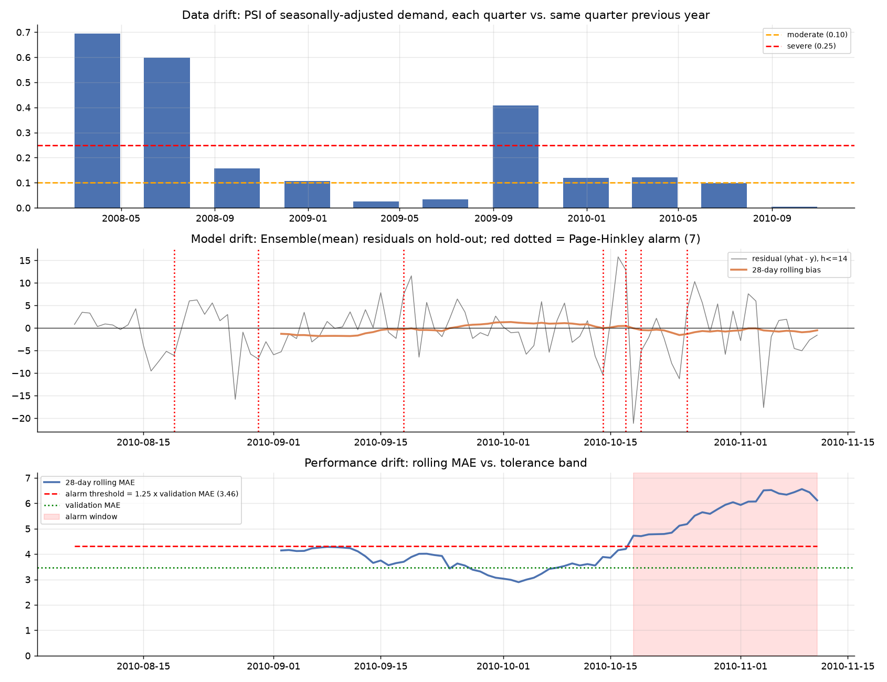

The top panel runs the PSI check through history: each quarter of seasonally adjusted demand
is compared with the same quarter one year earlier. Quarters above 0.10 are the periods when a
model trained on the previous year would have started to mis-estimate the level. The full
operating procedure (schedules, triggers, champion/challenger gate, rollback) is in
[`docs/retraining_and_drift_plan.md`](../docs/retraining_and_drift_plan.md).

## 8. Limitations and next steps

* One household is noisier than an aggregate; the same code runs unchanged on the M5 Walmart
  data (`DATASET = "m5"` in `src/config.py`, Kaggle files in `data/raw/m5/`).
* Weather (temperature, heating degree days) is the obvious missing driver of the yearly cycle;
  adding a forecast-temperature regressor to SARIMAX / Prophet / the GBM is the highest-value extension.
* Probabilistic forecasts: SARIMAX and Prophet give intervals; the deep and GBM models could use
  quantile loss or conformal calibration so the safety buffer becomes model-native.
* Deep models were trained on about 1,100 windows; they typically need more series (global models
  across many households or stores) to beat the statistical models decisively.
